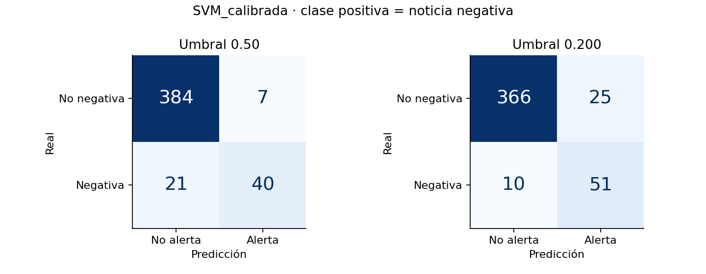
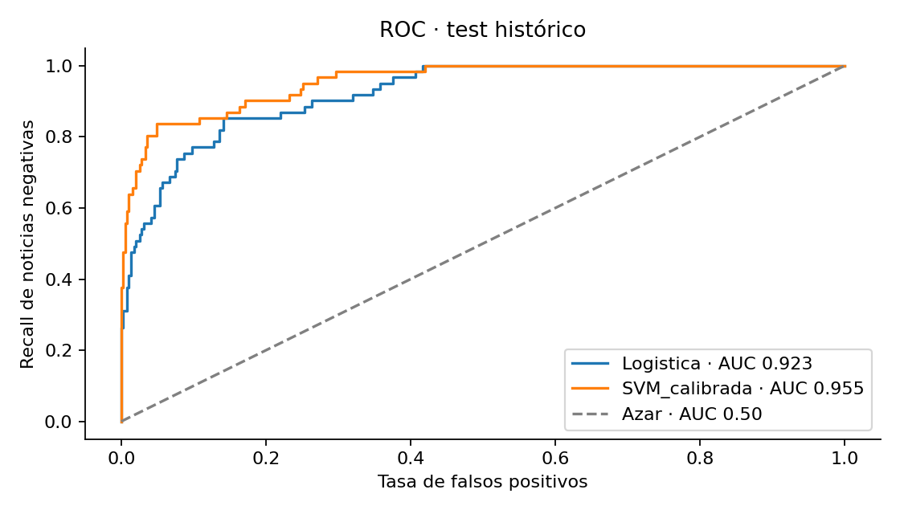
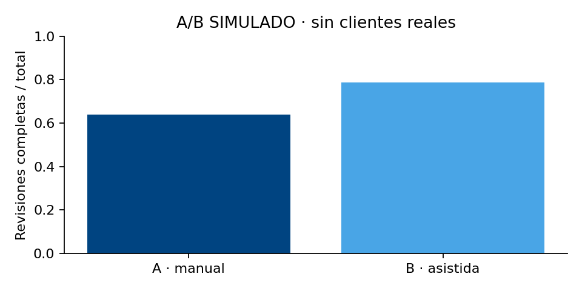

<p align="center"></p>
<h1 align="center">Actividad 6 · Evaluar antes de recomendar</h1>
<p align="center"><b>Asistente de preparación de revisiones de portafolio</b><br>Eduardo Aburto Angulo · Módulo 2 · Semana 7 · Temas 13 y 14</p>

Mi prioridad como Banquero Patrimonial Sr. es preparar revisiones que cuiden el perfil del cliente y busquen mejores rendimientos **netos**. Aquí evalúo un clasificador de noticias para priorizar revisión humana. Una alerta no es una orden de inversión ni una predicción de rentabilidad.

> **Decisión:** SVM calibrada, umbral **0.20**, como candidata académica por menor costo medio de validación cruzada. **La meta conjunta de recall ≥90 % y precisión ≥60 % no se alcanza.** Se requiere validación externa antes de un piloto operativo.

> **Segunda revisión · 23 de octubre:** corregí una incompatibilidad de instalación de MLflow y reproduje el entrenamiento completo en un entorno nuevo. [Revisión y cotejo de rúbrica](documentos/Revision_2.md) · [Pruebas de reproducción](resultados/reproduccion_revision2.json) · [Auditoría](resultados/auditoria_revision2.json).

## Empieza aquí

| Quiero… | Acceso directo |
|---|---|
| Leer la entrega de ocho páginas | [Reporte PDF](documentos/Actividad6_Eduardo_Aburto.pdf) · [Word](documentos/Actividad6_Eduardo_Aburto.docx) |
| Editar el reporte en Google | [Google Docs editable para el propietario](https://docs.google.com/document/d/1iSBlPG3uCCOoK02nPwPb33fWbSOUuntV_1oht4yMtNs/edit) |
| Revisar el tablero solicitado | [Trello](https://trello.com/b/2TN8TJQ1) · [Capturas en PDF sin necesidad de acceso a Trello](tablero/Evidencia_Trello.pdf) |
| Explorar resultados y costos | [Aplicación Streamlit](app.py) · [Cómo abrirla](#abrir-streamlit) |
| Ejecutar en Google Colab | [Abrir notebook](https://colab.research.google.com/github/eduardoaburtoa/actividad6-evaluacion-portafolios/blob/main/fuentes/entrena.ipynb) |
| Auditar los experimentos | [Capturas MLflow](evidencias/Evidencia_MLflow.pdf) · [Corridas en JSON](evidencias/mlflow_runs.json) · [Almacén portable](evidencias/mlflow_bundle.zip) |
| Consultar cifras exactas | [Métricas](resultados/metricas_test.csv) · [Predicciones](resultados/predicciones_test.csv) · [Folds](resultados/validacion_cruzada.csv) |
| Comprobar cobertura de la rúbrica | [Matriz de cumplimiento](documentos/Cobertura_rubrica.md) |

Google Docs y Trello conservan acceso de la cuenta o espacio de trabajo; el PDF y Word del repositorio permiten evaluar sin solicitar acceso. Streamlit está incluido como aplicación ejecutable; este repositorio por sí solo **no implica alojamiento en Streamlit Cloud**.

## Resultado en primera vista

| Política | Accuracy | Precisión | Recall | F1 | ROC-AUC |
|---|---:|---:|---:|---:|---:|
| **SVM · umbral 0.20** | **0.9226** | **0.6711** | **0.8361** | **0.7445** | **0.9548** |
| SVM · umbral 0.50 | 0.9381 | 0.8511 | 0.6557 | 0.7407 | 0.9548 |
| Logística · umbral 0.125 | 0.8053 | 0.3969 | 0.8525 | 0.5417 | 0.9229 |
| Baseline mayoritario | 0.8650 | 0 | 0 | 0 | 0.50 |
| Revisar todas | 0.1350 | 0.1350 | 1 | 0.2378 | 0.50 |



Bajar el umbral reduce omisiones de **21 a 10**, pero aumenta falsas alertas de **7 a 25**. La carga pasa de 47 a 76 revisiones. El costo didáctico `5×FN + FP` baja de 24.78 a 16.59 unidades por 100 noticias. **Estas unidades no son pesos ni pérdidas reales.**



## Qué se evaluó y qué no

- **Clasificación binaria:** positiva = noticia negativa. Neutral y positiva forman la clase no negativa. No comparar este F1 binario directamente con el F1 macro de tres clases de Actividad 5.
- **Datos públicos:** Financial PhraseBank AllAgree en inglés, 2,264 originales; 2,259 después de deduplicar. 1,807 desarrollo y 452 test. Conservamos fuente, licencia, manifiesto y partición.
- **Evaluación retrospectiva:** el test ya se examinó en Actividad 5. No es una muestra externa nueva ni evidencia de rentabilidad de fondos mexicanos.
- **Selección:** cinco folds externos estratificados; tres internos para elegir umbral; calibración sigmoide SVM dentro del entrenamiento. TF-IDF dentro de cada pipeline evita aprender vocabulario del fold evaluado.
- **Umbral:** rejilla 0.05–0.95, paso 0.025; minimiza costo bajo restricciones si son factibles. Si no, minimiza costo y registra la meta incumplida. Umbral final elegido con OOF de desarrollo, nunca optimizado en test.
- **Incertidumbre:** bootstrap estratificado pareado de 2,000 repeticiones. IC95 % AUC SVM [0.9284, 0.9761]. McNemar de exactitud entre umbrales p=0.2649: no demuestra mejora de exactitud. Los folds no son observaciones independientes.

La segunda revisión incorpora una **comparación exploratoria pareada entre algoritmos**: ΔAUC SVM−logística = 0.03186 (IC95 % [0.01987, 0.04570]) y ΔF1 = 0.20286 ([0.15107, 0.25334]). Es distinta del McNemar entre umbrales anterior. [Método, significancia y límites](documentos/Revision_2.md#comparación-estadística-adicional) · [Resultados completos](resultados/comparacion_pareada.json).

## A/B simulado y negocio



150 personajes ficticios, 75 por grupo, con asignación aleatoria por perfil. Éxito = revisión completa en 48 horas. A: 48/75; B: 59/75. Diferencia 14.67 puntos; **Fisher bilateral p=0.0703**, no significativo al 5 %. Intervalo aproximado conservador Wilson–Bonferroni: [−8.73, 36.23] puntos. Las probabilidades generadoras 0.72 y 0.85 son supuestos, no observaciones. **No demuestra efecto causal ni mejora de rendimiento real.**

Un piloto futuro necesita protocolo congelado, revisión humana, privacidad, análisis por intención de tratar y control de contaminación entre banqueros. La aproximación de tamaño da 156 por brazo, 174 con 10 % de pérdida; recalcular si se asigna por banquero.

Los 150 superhéroes y villanos tienen posiciones de $5–$20 millones MXN; no son personas reales ni datos de entrenamiento. El 1 % por venta más 1 % por compra es un **supuesto didáctico**, no una tarifa general verificada de BBVA. Las comisiones deben compararse sobre el mismo nocional y el horizonte relevante. Los gastos del fondo no equivalen al ingreso neto del banco; evitar descontarlos dos veces si el rendimiento ya es neto.

[Índice de 61 fichas BBVA](contexto/fichas_bbva.csv) · [693 registros por serie](contexto/comisiones_por_serie.csv). Consulta 22 de octubre de 2026; extracción automática que exige contrastar vigencia, periodicidad y serie en el PDF original. Es información contextual; no entra al clasificador.

## Reproducir la entrega

Python **3.12**, CPU, dependencias fijadas. No necesita GPU ni credenciales. Se probó en macOS ARM; otros entornos pueden presentar pequeñas diferencias numéricas.

```bash
git clone https://github.com/eduardoaburtoa/actividad6-evaluacion-portafolios.git
cd actividad6-evaluacion-portafolios
python -m venv .venv
source .venv/bin/activate
pip install -r requirements.txt
python fuentes/verificar.py
python fuentes/auditoria.py
python fuentes/experimento.py
```

En Windows, activa con `.venv\Scripts\activate`. `experimento.py` vuelve a entrenar y actualiza `resultados/`; conserva una copia si quieres comparar con la entrega. `mlflow.db` y `mlartifacts/` son almacenes locales ignorados por Git.

Para replicar el conjunto completo de versiones auditadas, usa `pip install -r requirements-lock.txt`. El archivo mínimo también fija SQLAlchemy 2.0.40: una resolución nueva con 2.1.6 impedía iniciar MLflow 2.22.2.

La [segunda revisión](documentos/Revision_2.md) documenta la reproducción de métricas, predicciones y validación cruzada, y amplía la comparación estadística sin modificar la selección original.

### Abrir Streamlit

```bash
streamlit run app.py
```

Cinco pestañas: resultados, umbral y errores, validación y A/B, cartera didáctica, fuentes y trazabilidad. El explorador del umbral sobre test está identificado como ilustrativo y no modifica el umbral publicado. La aplicación se comprobó con Streamlit AppTest.

### Ver MLflow sin volver a entrenar

```bash
python fuentes/restaurar_mlflow.py
```

Ejecuta la instrucción que imprime el script. Restaura en `mlflow_evidencia/` y adapta rutas locales. El paquete conserva seis corridas: tres exploratorias y tres definitivas. Los modelos finales son:

- Logística: `e5e4c5b65b264862a3ed291c6f9de925`.
- SVM: `43e834e14e7b4ae7b7b387ef8cca63ca`.
- Comparación y A/B: `77fb4ff5c5234de5a7f5679fca01dc38`.

Los modelos `.joblib` están guardados como artefactos; no se afirma un registro productivo de modelos. Carga sólo artefactos de origen confiable. [Historial y decisiones](CHANGELOG.md).

## Mapa del repositorio

```text
Actividad6 (raíz del repositorio)
├── app.py                       # Streamlit
├── fuentes/                     # Experimento, notebook, verificación, restauración
├── datos/datos_ini/              # Fuente original y licencia
├── datos/datos_limp/             # Versión limpia y partición histórica
├── contexto/                    # Personajes y fichas BBVA
├── resultados/                  # Predicciones, métricas, modelos y figuras
├── evidencias/                  # Capturas y almacén MLflow portable
├── tablero/                     # Trello y capturas PDF
├── documentos/                  # Reporte Word/PDF y cobertura
├── requirements.txt
└── CHANGELOG.md
```

## Continuidad y fuentes

- [Actividad 4 · motor-senales-nlp](https://github.com/eduardoaburtoa/motor-senales-nlp).
- [Actividad 5 · MLflow](https://github.com/eduardoaburtoa/actividad5-mlflow-portafolios), base `ffcab30094541ebbe7f52f1c55062068d59e1e4f`.
- [Financial PhraseBank · revisión fijada](https://huggingface.co/datasets/takala/financial_phrasebank/tree/8d3fe0c36d5feec6b3cc5e455b0fcb4820fb9964). Malo, Sinha, Takala, Ahlgren y Lappalainen. Licencia **CC BY-NC-SA 3.0**, conservada en datos; no se otorga permiso comercial adicional.
- [Ajuste de umbral · scikit-learn](https://scikit-learn.org/stable/auto_examples/model_selection/plot_tuned_decision_threshold.html).
- [Calibración · scikit-learn](https://scikit-learn.org/stable/modules/generated/sklearn.calibration.CalibratedClassifierCV.html).
- [Fisher exacto · SciPy](https://docs.scipy.org/doc/scipy/reference/generated/scipy.stats.fisher_exact.html).
- [MLflow Tracking](https://mlflow.org/docs/latest/ml/tracking/).
- [Normativa de fondos · BBVA México](https://www.bbva.mx/personas/productos/inversion/normativa-de-fondos.html).
- Temas 13 y 14 y rúbrica Actividad 6 proporcionados por el curso; se consultaron sin redistribuir material docente.

Trabajo académico personal. Identidad Vértice AI y paleta azul solicitada; no constituye un producto oficial ni una recomendación institucional de BBVA.
